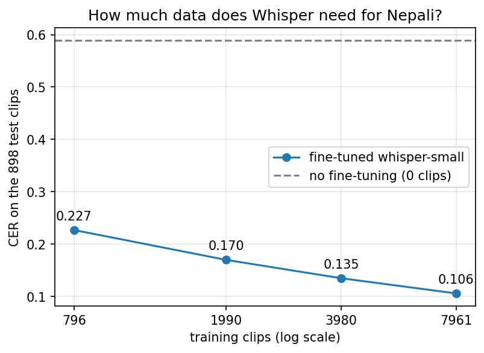

# Nepali Speech Recognition: Fine-tuning Whisper-small on OpenSLR SLR54

I fine-tuned OpenAI's `whisper-small` for Nepali speech-to-text and tested it on speakers
that the model never saw in training. This repo has the data splits, the predictions, the
results and the error analysis. Model weights and audio are not stored here.

Status: work in progress. Only one of the 16 data shards of SLR54 is used so far.

## Main result

Test set: 898 clips from speakers that are not in the training set. No test text appears in the training set.

| Model | Generation settings | WER | CER |
|---|---|---|---|
| whisper-small (no fine-tuning) | repeat guard | 1.363 | 0.589 |
| whisper-small (fine-tuned on 7,961 clips) | repeat guard | 0.391 | 0.106 |
| whisper-small (fine-tuned on 7,961 clips) | no repeat guard | 0.382 | 0.104 |

WER can be above 1 because inserted words count as errors. The untrained model often repeats
words, so CER is easier to read here. "Repeat guard" means `no_repeat_ngram_size=4`.

## Data

- Source: OpenSLR SLR54, Nepali ASR training data (https://openslr.org/54/), license CC BY-SA 4.0.
- I used one shard, `asr_nepali_0.zip`: 9,935 of 157,905 utterances (about 6%) from 526 speakers.
- Split by speaker (about 80/10/10), then validation and test rows whose text also appears in train were removed.
- Final sizes: train 7,961, validation 933, test 898 clips. The lists are in `results/splits/`.
- The texts are very short (about 3 words on average) and most are read phrases.

## Training (first run, 100% of the training clips)

- 3 epochs, learning rate 1e-5, 50 warmup steps
- Batch size 8 with gradient accumulation 2 (effective batch size 16), fp16, gradient checkpointing
- Google Colab T4 GPU, about 72 minutes
- Evaluation every 250 steps on 300 random validation clips: validation CER went from 0.177 (half an epoch)
  to 0.109 (3 epochs). Validation loss stopped improving after epoch 2 while training loss kept falling,
  so the model started to memorize the training clips.

## How much training data does Whisper need?

I fine-tuned `whisper-small` on 10%, 25%, 50% and 100% of the training clips (nested subsets, same
settings, 3 epochs, learning rate 1e-5) and tested every model on the same 898 test clips. One training run per size.

| Training clips | Share | About (hours) | CER | WER | CER, no repeat guard | WER, no repeat guard |
|---|---|---|---|---|---|---|
| 0 (no fine-tuning) | 0% | 0 | 0.589 | 1.363 | not measured | not measured |
| 796 | 10% | 0.8 | 0.227 | 0.691 | 0.235 | 0.689 |
| 1,990 | 25% | 1.9 | 0.170 | 0.568 | 0.167 | 0.562 |
| 3,980 | 50% | 3.9 | 0.135 | 0.472 | 0.133 | 0.465 |
| 7,961 | 100% | 7.7 | 0.106 | 0.391 | 0.104 | 0.382 |

The hours are estimates (about 3.5 seconds per clip, measured on a sample of 500 clips).

The dashed line in the chart is the untrained model (0 clips). A log axis cannot show zero.

What I see:
- Between 796 and 7,961 clips, CER fell by about 20% (relative) for each doubling of the data
  (19.6%, 20.6% and 21.5% between neighbouring sizes).
- Before the 50% run I predicted a CER of about 0.135 from the first three points. The measured value was 0.135.
- 796 clips (about 0.8 hours) already give about 75% of the CER drop of the 7,961-clip model.

## Error analysis (898 test clips, fine-tuned model, no repeat guard)

- 606 clips are not an exact match (exact match about 32.5%).
- Word errors: 846 substitutions, 86 deletions, 75 insertions.
- Punctuation hardly matters: raw WER/CER 0.382/0.104 vs 0.381/0.103 with punctuation removed.
  30 clips differ only by joined or split words.
- Digits are harder: CER 0.183 on the 64 clips with digits in the reference vs 0.095 on the other 834.
- Most common single-character mix-ups: vowel length (ी/ि, ू/ु), श/स, ब/व, द/ध.
- Spelling-tolerant diagnostic (not a model score): merging letters that I believe sound the same
  (ी/ि, ू/ु, श/ष/स, ब/व) in both texts gives WER 0.352 and CER 0.092, and 39 clips become exactly correct.

### Manual review of 50 clips

I took a random sample of 50 of the 565 test clips that were still wrong after the letter merge and
labeled each by hand (one annotator). Each clip got one category, based on its first mistake from left to right.
The rules were refined while labeling, a first round of labels was discarded, and borderline cases are judgment calls.
The labels are in `results/manual_review/`.

| Category | Clips | Percent (rough range) |
|---|---|---|
| Same word, small letter difference | 26 | 52% (+/-13.8) |
| Different or nonsense word | 10 | 20% (+/-11.1) |
| Joined or split words | 6 | 12% (+/-9.0) |
| Reference does not match the audio | 4 | 8% (+/-7.5) |
| Wrong number | 3 | 6% (+/-6.6) |
| Name or rare word | 1 | 2% (1 clip, no reliable range) |

With only 50 clips these shares are rough.

## Limitations

- One training run per size, so small differences between neighbouring sizes are not reliable.
- With less data the model also gets fewer update steps (3 epochs each), so "less data" and "fewer steps" are mixed together.
- Only four training sizes were tested, up to 7,961 clips. I make no claim beyond that range.
- The training data is mostly short read phrases, so the model may be weaker on long, natural speech.
  It was not tested on my own recordings or on other datasets yet.
- Only one data shard was used.
- The 100% model comes from my first training run (it was evaluated during training). The other three
  runs used a separate script with the same settings.

## Files

- `results/splits/`: train, validation and test lists (file IDs, speaker IDs, text)
- `results/baseline_*`, `results/finetuned_*`: metrics and predictions of the untrained and the 100% model
- `results/data_size/`: results table and test predictions of the data-size experiment
- `results/figures/`: the chart
- `results/manual_review/`: the 50 hand labels and their summary
- `results/training_log.json`: loss and error numbers of the first training
- `notebooks/`: Colab notebooks

## Credits

Dataset: OpenSLR SLR54 (Nepali ASR). Base model: OpenAI Whisper.
